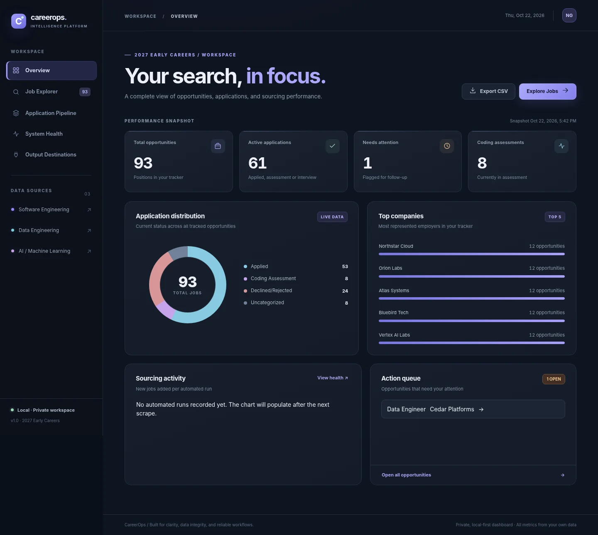
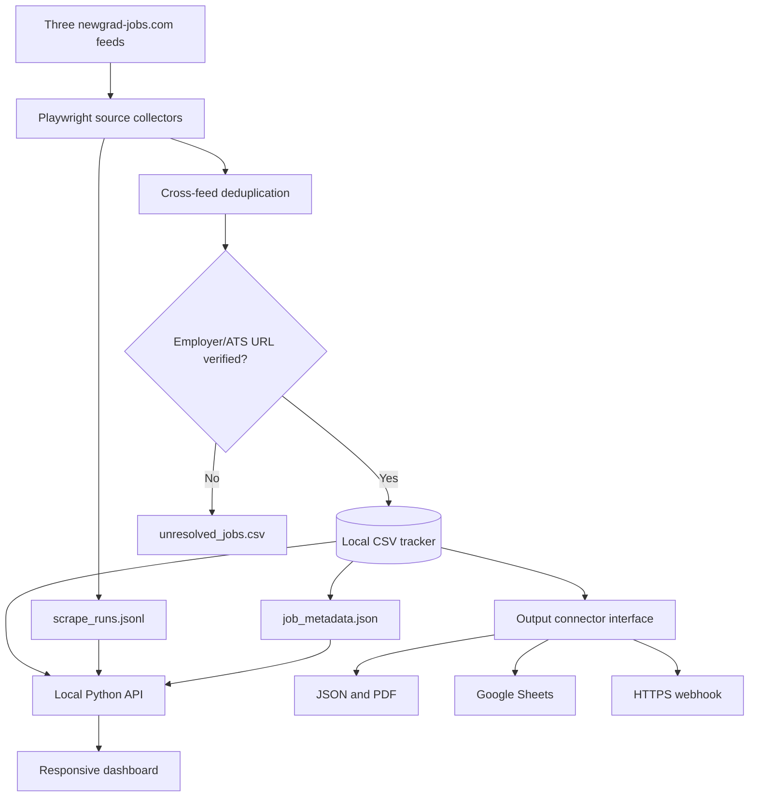

<div align="center">


# CareerOps

**A local-first job intelligence platform.**  
Find opportunities. Track progress. Route data to the tools you already use.

[](https://www.python.org/)
[](https://github.com/HarshithM834/New-Grad-Daily-Job-Scraper/actions/workflows/tests.yml)


**[Getting started](#quick-start)** · **[Dashboard](#dashboard)** · **[Output connectors](#output-connectors)** · **[Architecture](#architecture)** · **[Limitations](#current-limitations)**



<sub>Interface preview with illustrative demo data, not actual scrape statistics.</sub>

</div>

---

## Why CareerOps?

A job search is a fragmented data pipeline: listings appear on multiple boards, application links route through aggregators, and application tracking drifts across spreadsheets. CareerOps brings those steps into **one auditable local workflow**—without requiring a cloud database or paid dashboard service.

| Discover | Organize | Deliver |
|:--|:--|:--|
| Scrape SWE, Data Engineering, and AI/ML feeds | Search, filter, and update application stages | Export to CSV, JSON, or a printable PDF |
| Deduplicate across the three sources | View a pipeline board, activity, and quality metrics | Sync to Google Sheets or send an HTTPS webhook |
| Follow Jobright's application action to find employer/ATS links | Preserve existing tracker notes and decisions | Choose output destinations independently of scraping |

### Dashboard

The responsive interface includes **Overview**, **Job Explorer**, **Application Pipeline**, **System Health**, and **Output Destinations**. Search and stage updates operate on the local tracker. System Health reads a real run log and shows unresolved application URLs and provenance; it does not fabricate activity when no runs have occurred.

The dashboard runs on `127.0.0.1` and is **not** a hosted service. No login or SaaS account is required for the local UI.

## Quick start

**Requirements:** Python 3.12+ and the Playwright Chromium browser for live scraping. On macOS/Linux:

```bash
git clone https://github.com/HarshithM834/New-Grad-Daily-Job-Scraper.git
cd New-Grad-Daily-Job-Scraper
python -m venv .venv
source .venv/bin/activate
pip install -r requirements.txt
python -m playwright install chromium
```

**Open the dashboard:**

```bash
python dashboard_server.py
# Open http://127.0.0.1:8765
```

**Run a small live scrape:**

```bash
python scraper.py --max-jobs-per-source 10 --scroll-steps 2
```

**Run offline regression tests:**

```bash
python -m unittest discover -s tests -v
```

### Bring your own tracker

Your personal tracker does **not** have to use the filename included in this repository. CareerOps reads any CSV with these seven exact headers: `Company,Role,Link,Location,Stage,To-do,Notes`.

```bash
cp examples/tracker-template.csv my-jobs.csv
export CAREEROPS_CSV_PATH="$PWD/my-jobs.csv"
python dashboard_server.py
# In another terminal, from the same folder/environment:
python scraper.py --max-jobs-per-source 10
```

On Windows PowerShell, use `$env:CAREEROPS_CSV_PATH = "$PWD\my-jobs.csv"` instead of `export`. The scraper adds only confirmed direct URLs; when it cannot verify an employer/ATS link, it records the listing in `unresolved_jobs.csv` for manual review. Existing application stages and notes are never reset by a scrape.

## Output connectors

The connector system is **opt-in**. The local CSV is the source of truth; other outputs are independent mirrors or reports.

| Destination | Mode | Configuration |
|:--|:--|:--|
| **CSV** | Primary local tracker | No configuration required |
| **JSON** | Structured snapshot written to `exports/jobs.json` | Enable in Dashboard → Output Destinations |
| **PDF** | Printable report written to `exports/careerops-report.pdf` | Enable in Output Destinations or download on demand |
| **Google Sheets** | Outbound full-sheet snapshot | Spreadsheet ID, worksheet, and service-account credentials |
| **HTTPS webhook** | Outbound JSON POST for n8n, Make, Zapier, or custom APIs | HTTPS endpoint; optional bearer token |

Use **Save destinations** to store local preferences, then **Sync enabled outputs now**. Local preferences are written to `destinations.local.json` with restricted permissions and excluded from Git. An example format is available as `examples/destinations.example.json`.

#### Google Sheets connection

1. Create a Google Cloud service account with Google Sheets API access, download its credential JSON, and share the target spreadsheet with the service account email.
2. Set `GOOGLE_APPLICATION_CREDENTIALS` to the **local path** of that JSON (never commit it).
3. In Output Destinations, enter the spreadsheet ID and existing worksheet/tab name; enable Google Sheets and save.
4. Sync from the dashboard. **Important:** the connector replaces values in columns A–G of the selected tab. It is **not bidirectional**; edits made directly in Sheets will not be imported into the tracker.

#### Automating destinations on GitHub Actions

The scheduled scraper checks **SWE**, **DE**, and **AI/ML** daily at **13:00 UTC** (09:00 EDT / 08:00 EST), with a default cap of 50 listings **per feed**. Select *Actions → Daily new grad SWE, DE and AI/ML jobs → Run workflow* to initiate a manual run.

Because local destination preferences are deliberately gitignored, use these **GitHub Actions repository secrets** for headless outbound sync:

- `CAREEROPS_DESTINATIONS_JSON` — JSON in the same format as `examples/destinations.example.json`, with your selected outputs enabled.
- `GOOGLE_SERVICE_ACCOUNT_JSON` — complete Google Cloud service account credential JSON if using Google Sheets.
- `CAREEROPS_WEBHOOK_TOKEN` — optional bearer token for a webhook.

The scheduled workflow installs Chromium, runs offline tests, attempts each source, syncs opted-in destinations, and commits updated tracker/run-history files. The workflow needs repository Contents write permission. Scheduled runs can be delayed, blocked by source sites, or disabled in inactive repositories.

> **Privacy:** This repository is currently public. Any tracked CSV, job notes, or generated run metadata committed to it may be publicly visible. For personal tracking, use a **private repository**, and never commit API keys, service account JSON, or sensitive application notes. A hosted multi-user deployment would require proper authentication and isolation, which are outside the current scope.

## Architecture



**Core modules:** `scraper.py` (extraction, deduplication, URL resolution); `dashboard_server.py` (loopback API + tracker updates); `dashboard/` (HTML, CSS, vanilla JavaScript); `output_connectors.py` (configurable integrations); `tests/` (offline regressions); `.github/workflows/` (CI and daily schedule).

## Data integrity and security

- **Direct-link policy:** newly scraped jobs must resolve to a non-aggregator employer or applicant-tracking-system URL. Unresolved links are separated rather than mislabeled as direct applications. Historical imported records may still contain aggregator URLs and are identified in the dashboard.
- **Non-destructive job tracking:** the scraper appends new jobs without resetting existing statuses or notes; manually edited stages are written atomically to the CSV.
- **Traceable operations:** a JSONL log stores run dates, statuses, feed counts, and outcomes. Newly added links have source/category metadata in a separate file without changing the seven-column CSV schema.
- **Local UI boundary:** the dashboard listens only on `127.0.0.1`, validates edit input, checks request origin, uses restrictive browser security headers, and prevents common spreadsheet-formula injection for newly saved notes.
- **Opt-in outbound data:** Google Sheets and webhooks receive job records only when enabled; destination config and credentials are excluded from Git.

## Current limitations

This is an interview-ready **local project**, not a production SaaS platform. Source extraction currently supports the three configured newgrad-jobs.com feeds; arbitrary job-board websites would require source adapters. Jobright may change its DOM or block access. Employer links sometimes require authentication or open a blocked popup, so successful resolution is not guaranteed. Live end-to-end scraping and outbound Google Sheets/webhook delivery depend on external sites and your credentials; the committed automated tests use offline fixtures and mocks.

The dashboard does **not** automatically sync edits *back* from Google Sheets. Source history and quality charts require real scraper runs; before the first run they correctly appear empty. Secrets and personal data should not be published in a public GitHub repository.

## Next steps

Potential extensions include a plugin registry for additional job boards, SQLite/PostgreSQL persistence, OAuth connections for hosted Sheets, deployment authentication, alerting on new matching jobs, and retry/backoff policies for source failures.

---

<div align="center"><sub>CareerOps · Built with Python, Playwright, native web technologies, and a preference for observable, portable data flows.</sub></div>

## CareerOps v1 development preview

The optional modern dashboard source lives in `web/` (React, Vite, Tailwind, owned shadcn-style components, Radix accessibility primitives). It complements rather than replaces the dependency-free fallback dashboard.

```bash
# Install the normal Python dependencies and Chromium as above.
cd web
npm install
npm run build
cd ..
python dashboard_server.py
# Visit http://127.0.0.1:8765
```

For UI development, run `npm run dev` from `web/` with the Python server running in another terminal. Without `web/dist/`, the original dashboard remains available.

### Optional source and seniority filtering

```bash
python scraper.py --categories SWE,DE --max-jobs-per-source 25
python scraper.py --categories AI/ML --likely-new-grad-only
```

The `--likely-new-grad-only` flag uses explicit job-title evidence and deliberately excludes ambiguous roles; it is **off by default** to avoid losing potentially relevant jobs. The source's `isNewGrad` field is not treated as a reliable hard filter.

### Source-contract checks and contributing

Run `python feed_health.py --json` for read-only feed-contract diagnostics. It does not verify all pages or final application links. See [CONTRIBUTING.md](CONTRIBUTING.md) and [DESIGN.md](DESIGN.md); the code is under the [MIT License](LICENSE).

> **Privacy warning:** This repository currently contains a previously committed personal CSV tracker. For an open-source release, remove personal application data from the published repository and its Git history (if appropriate) and use the sanitized example CSV instead. Never commit credentials.

## Multi-source new-grad collection

CareerOps now connects **six providers** (three categories on newgrad-jobs.com plus five GitHub-maintained new-grad sources) through one command. Each community feed supplies direct employer URLs when available; the Jobright source still tries the actual Apply Now redirect and queues unresolved listings.

```bash
# Fetch all six providers and sync enabled destinations
python careerops.py

# Preview curated feeds without touching your tracker or starting Chromium
python careerops.py --dry-run

# Run curated sources only
python careerops.py --skip-jobright

# Select sources and categories
python careerops.py --community-feeds vansh,speedy-swe,applyguy --categories SWE,DE
```

The default collection is **new-grad and entry-level only**. Explicit internships, senior and lead roles are filtered out. Dedicated graduate-list inclusion counts as eligibility evidence for otherwise unmarked community roles; Jobright's ambiguous roles are excluded by default. Job postings can close or be mislabeled. External employer links from curated lists are screened for being job-specific but are not guaranteed live.

All existing outputs remain configurable by the user: CSV, JSON, printable PDF, Google Sheets, HTTPS webhook, plus optional Excel (`artifact_tool` required). The system remains local-first and preserves all existing application stages and notes. See [MULTISOURCE.md](MULTISOURCE.md) and [SOURCES.md](SOURCES.md) for implementation details, URLs and caveats.

A scheduled workflow collects these sources daily. To operate an open-source template safely, keep your own tracker private: this repository **already contains a personal tracker in prior commits** and removing the latest file alone will not purge it from history.